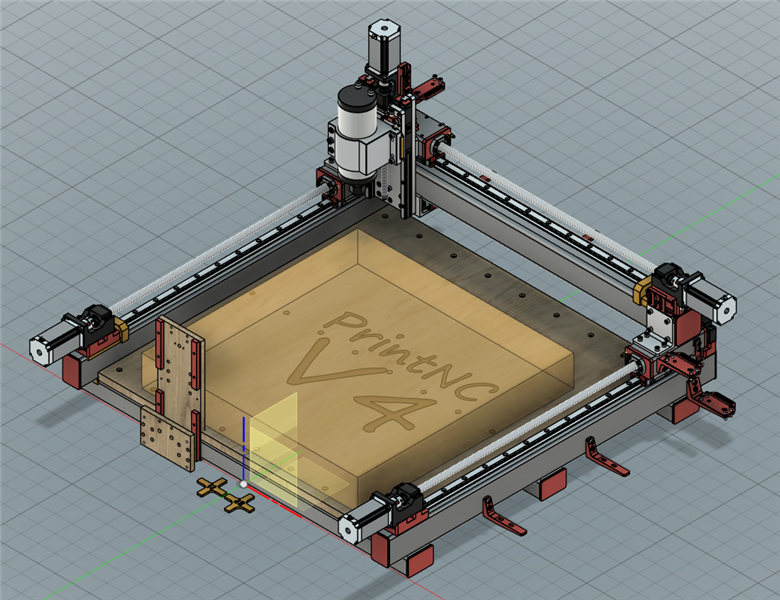
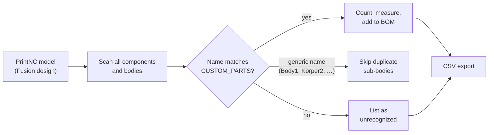
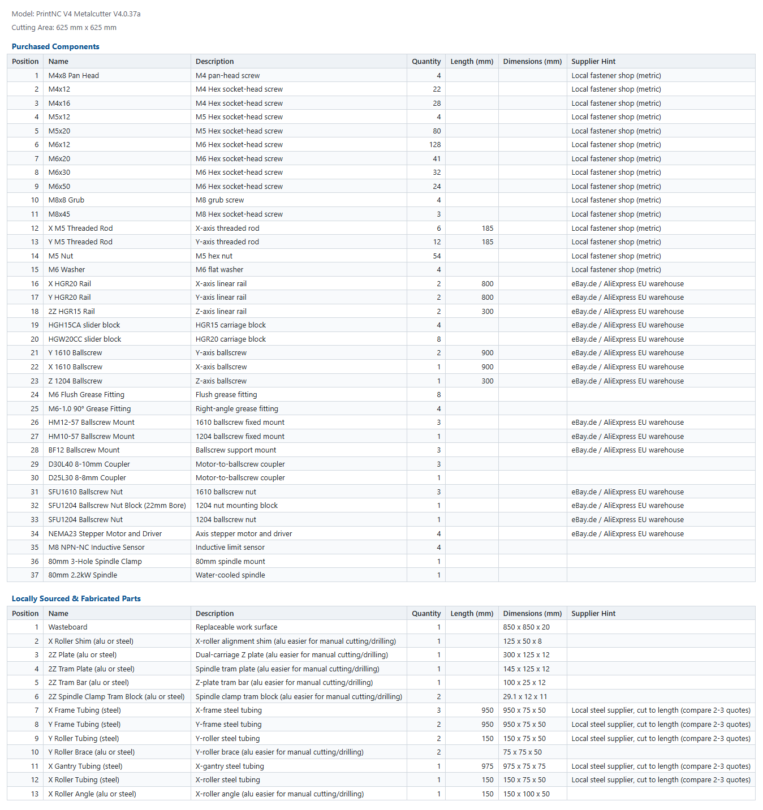

# PrintNC BOM Generator

A Fusion script that turns the **PrintNC** CAD model into a ready-to-order **Bill of Materials** (CSV): every screw, rail, ballscrew and steel tube, with quantities, lengths and dimensions.

<p align="center"></p>

## How it works



- Recognizes parts by body (or component) name and aggregates quantities.
- Measures lengths and `X x Y x Z` dimensions in mm.
- Splits the BOM into **purchased** and **fabricated** parts.
- Works with models edited in any Fusion UI language.

## Quick start

1. Download [`generate_bom.py`](generate_bom.py).
2. In Fusion, open **Scripts and Add-Ins** (`Shift+S`) and create a new Python script named `generate_bom` ([Fusion manual](https://help.autodesk.com/view/fusion360/ENU/?guid=GUID-9701BBA7-EC0E-4016-A9C8-964AA4838954)).
3. Replace the generated `generate_bom.py` with the downloaded one.
4. Open your PrintNC design, run the script, and choose where to save the CSV.

## Result

Tested with **PrintNC V4 Metalcutter V4.0.37a** (cutting area 625 × 625 mm) in Fusion 2706:

| Section | Rows | Example |
| --- | ---: | --- |
| Purchased components | 37 | 4 × HGR20 rail 800 mm, 8 × HGW20CC block, 3 × SFU1610 ballscrew 900 mm, 4 × NEMA23 |
| Fabricated parts | 13 | 3 × X frame tubing 950 × 75 × 50, 2Z plate 300 × 125 × 12 |
| Unrecognized parts | **0** | every body in the model is accounted for |

The CSV opens directly in Excel or LibreOffice Calc. With supplier hints enabled it looks like this:

<p align="center"></p>

## Configuration

Everything is set at the top of `generate_bom.py`.

| Setting | Purpose |
| --- | --- |
| `CUSTOM_PARTS` | Part catalog. The key is matched (lowercase, prefix) against body or component names. |
| `INCLUDE_SUPPLIER_HINTS` | `True` adds a *Supplier Hint* column (EU sourcing routes). Default `False`. |
| `IGNORED_COMPONENT_PATH_PARTS` | Components to skip (cutting area, plywood, drill guides, …). |
| `GENERIC_BODY_NAMES` | Fusion's default body names per language, filtered as duplicates. |

Fields of a `CUSTOM_PARTS` entry:

| Field | Meaning |
| --- | --- |
| `name`, `description` | Shown in the BOM. |
| `show_length` / `show_dimensions` | Print the longest edge / full `X x Y x Z` size. |
| `override_quantity` | `False` counts bodies; an integer sets a fixed quantity. |
| `category` | `"purchased"` (default) or `"fabricated"`. |
| `aliases` | Extra keys that match the same part. |
| `supplier_hint` | Sourcing hint for the optional column. |

```python
"hgw20cc": {
    "name": "HGW20CC slider block",
    "description": "HGR20 carriage block",
    "show_length": False,
    "show_dimensions": False,
    "override_quantity": False,
    "supplier_hint": SUPPLIER_EU_ONLINE,
},
```

Keys match by prefix, so put more specific keys before general ones.

## Contributing

Issues and pull requests are welcome, especially new parts and supplier hints for your region. Thanks to [@xmirakulix](https://github.com/xmirakulix) for the part descriptions and to [@estovisioncontact-bit](https://github.com/estovisioncontact-bit) for the EU sourcing idea ([#8](https://github.com/interias/PrintNC-BOM-Generator/pull/8)).

Questions: GitHub Issues or Discord **#sbrzl_3.14**. Licensed under [MIT](LICENSE).
